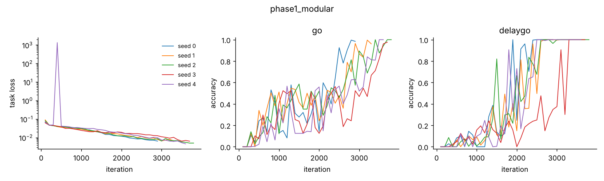

# Technical notes

The plain-language overview is in `HOW_IT_WORKS.md`; this file is for anyone who
wants to check or defend the design.

## The science in plain language

**Why a recurrent network?** Yang et al. (2019, *Nature Neuroscience*) trained
one recurrent neural network (RNN) on about 20 cognitive tasks, the kind used
in monkey experiments: look toward a light, look away from it, remember where
it was, decide which of two stimuli is stronger, and so on. Without being told
to, the network split itself into groups of units that each served a subset of
the tasks, a bit like brain areas. Driscoll, Shenoy & Sussillo (2024) went
further: switching off ("lesioning") one group only hurt the tasks that use
the computation that group performs.

**What we add.** Instead of only letting groups emerge, we also *design*
regions and can compare the two:

* `sensory`: receives every light and tone
* `memory`: holds information across delays
* `conceptual`: a top-down, abstraction module. It is the model's analogue
  of the anterior temporal lobe, by *role in the wiring*, nothing more.
* `executive`: receives the task instruction and drives the output

A "flat" model (one unstructured block of the same size) is the control.

**The motivating question.** Snyder's "release" hypothesis (Snyder 2009,
*Phil. Trans. R. Soc. B*) proposes that inhibiting the left anterior temporal
lobe can expose raw low-level detail that top-down processing normally
discards, possibly including absolute pitch. We can test a model version of
this: train a network on a *relative* pitch task (was the second note higher
or lower?), where knowing the exact note is useless,
then weaken `conceptual` or its feedback to `sensory`, and measure whether
absolute pitch becomes *more decodable* from the network's activity. A
null result is a result, and we will report it as one.

## The model

Each unit has a firing rate *r* that follows

    tau * dr/dt = -r + f( gain * (W_rec r + W_in u + b + noise) )

* `f` is softplus (a smooth ReLU: rates are never negative).
* `tau` (default 100 ms) sets how fast a unit responds; it can differ per
  region. Simulated with Euler steps of `dt = 20 ms`.
* `W_rec` (unit → unit) is masked: only connections listed as pathways exist.
  Default wiring: sensory↔memory, sensory↔conceptual, conceptual↔executive,
  memory↔executive. conceptual→sensory is the top-down feedback.

### Design choices you may be asked to defend

* **Dale's law (on by default).** Each unit is either excitatory (80%) or
  inhibitory (20%): all its outgoing weights share one sign. Real neurons
  work this way, and it makes "weaken inhibition" a meaningful experiment.
  Implemented as `W = |W_raw| * sign(presynaptic unit)`, which training cannot
  break (tested).
* **Long-range connections are excitatory only.** Between regions only
  excitatory units project, as with long-range cortical projections;
  inhibition is local. As a consequence, cutting a pathway removes only
  excitatory drive.
* **Balanced initialisation.** Inhibitory weights start 4× stronger than
  excitatory ones (there are 4× fewer inhibitory units), so the untrained
  network is not runaway-excitatory. The whole matrix is then scaled to
  spectral radius 1.0.
* **Noise scaled by √(2/α).** This keeps the noise level the same if you
  change `dt` (the standard way to discretise continuous noise).
* **Inputs are routed.** Lights and tones enter `sensory` only; the task rule
  enters `executive` only; the readout reads `executive` only. So every task
  *has* to route information through the region graph, otherwise lesions would
  be meaningless. The fixation/go cue enters both `sensory` and `executive`
  (see Phase 2 notes). In the flat model everything connects to the single block.
* **Lesion = zero output.** A lesioned unit's rate is forced to exactly 0 at
  every step, so it sends nothing anywhere (tested). Zeroing only its input
  would leave the bias and noise still driving it.
* **Knobs are buffers, not weights.** Lesion masks, τ, noise, gain and a
  weight multiplier are stored separately from the trained weights, so any
  perturbation can be applied to (and removed from) a trained network without
  retraining.
* **Stricter scoring than Yang et al.** A trial counts as correct only if
  the network *held fixation until the go cue* and then reported the right
  direction (within 36°). Yang et al. only checked the last time step, which
  would hide "responds too early", a likely lesion effect.
* **Seeds are the unit of replication.** Every result is averaged over
  independently trained networks (default 5 seeds), with 95% confidence
  intervals over seeds. Trials from one network are not independent evidence.
* **Pressure knobs.** `train.l2_rate` and `train.l2_weight` penalise high
  activity and large weights. Without some pressure a network has no reason to
  throw information away, which matters for the absolute-pitch question.

## Tasks

Directions are shown as a bump of activity over 16 direction-tuned input units
(on one of two "modalities"). Tones are a bump on 36 tonotopic units covering
two octaves (C4–C6, log-frequency axis). Before the go cue the network must
keep its fixation output high; then it answers either with a direction (16
ring outputs, correct within 36°) or with one of two choice outputs.

| Task | Name in code | Source |
|---|---|---|
| Look at the light | `go` | Yang et al. "fdgo" |
| Look away from the light | `anti` | Yang et al. "fdanti" |
| Remember where the light was | `delaygo` | Yang et al. |
| Pick the brighter light (channel 1 / 2) | `dm1`, `dm2` | Yang et al. |
| Pick the brighter light, ignoring the other channel | `ctxdm1`, `ctxdm2` | Yang et al. |
| Same place twice? Then look | `dms` | Yang et al. "dmsgo" |
| Different place? Then look | `dnms` | Yang et al. "dnmsgo" |
| Did the tune go up or down? | `pitchdir` | new |
| Same tune in a new key? (implemented, **not trained**: see Phase 2 notes) | `relpitch` | new |

Every timing and stimulus parameter is listed at the top of
`brain_sandbox/tasks/yang.py` and `brain_sandbox/tasks/pitch.py`, and any of
them can be overridden from a config file. Tests check the ground truth of
every task (`tests/test_tasks*.py`).

## Phase 1 results

Commit `5fce26f`, 5 seeds per model, trained until every task reached ≥95% at
two evaluations in a row. Scored on 1000 fresh trials per task (stricter rule
above). 95% CI over seeds.

| Model | Go | Delay-Go | Iterations to criterion (per seed) |
|---|---|---|---|
| modular (4 regions) | 0.989 [0.976, 1.002] | 1.000 [1.000, 1.000] | 2900, 3300, 3800, 3700, 3600 |
| flat (1 block) | 1.000 [1.000, 1.000] | 0.993 [0.988, 0.999] | 3700, 2500, 4600, 4300, 5600 |

About 4–8 minutes per seed on 2 CPU threads. Figures: `phase1/`.
(A CI upper bound above 1.0 is an artefact of the t-interval on 5 values
that sit close to 1; read it as "≈1".)

### Phase 1 notes (things found on the way, kept for the record)

* **Learning rate.** With `lr = 1e-3` the modular model had not learned
  either task after 4000 iterations, while the flat model learned Go within
  500. Diagnosis: the modular model *did* report the right direction (median
  error 4°) but its fixation output drifted down during the stimulus. It
  failed to use the fixation cue, which must travel sensory → memory or
  conceptual → executive through sparse, excitatory-only pathways.
  `lr = 3e-3` fixed this on seed 0; `dale: false` did not. The learning rate
  was chosen for *training success only*, before any perturbation experiment.
* **Evaluation bug fixed.** Trials in a batch share their timing, so evaluating
  in batches of 128 meant each task was scored on only 2 different timings.
  That made accuracy jump between 0 and 1. Evaluation now uses batches of 16.
* **One instability.** Modular seed 4 had a loss spike (~10³) at iteration
  ~400 (runaway activity), then recovered thanks to gradient clipping.
* **Thin fixation margin.** In the trained modular model the fixation output
  sits around 0.65 during the delay (target 0.85, threshold 0.5). Small
  perturbations may therefore show up first as "breaks fixation early".
  Phase 3 will report fixation breaks and wrong directions *separately* so
  this failure mode does not mask more specific effects.
* **Delay activity is not confined to `memory`.** `sensory` and `conceptual`
  units also hold elevated activity through the delay (see
  `phase1/example_delaygo_modular_seed0.png`). Region names describe
  wiring, not function.
* **Reproducibility scope.** Identical seed *and* identical
  `train.num_threads` give bit-identical results (tested). A different
  thread count changes floating-point summation order, so the training
  trajectory differs.

## Phase 2 notes (changes made on the way, kept for the record)

* **The melody task could not be learned in our budget.** "Same tune in a new
  key?" (3-note melodies, the second transposed, sometimes with one note
  changed) stayed at chance (~50%) after 12,000 iterations in the full model,
  and after 3,000 iterations when trained *alone*, in 7 variants (smaller or
  bigger note changes, 2-note "intervals", longer tones, lower learning rate,
  flat model). We replaced it with the simplest relative-pitch judgement,
  "did the second note go up or down?". It keeps the property the release
  experiment needs (the absolute pitch of the notes is useless for the
  answer) but it is a much weaker form of "relative pitch" than melody
  recognition. The melody task stays in the code for anyone with more compute.
* **Go cue also to executive.** In the pitch-direction task trained alone,
  76% of answered trials were right, but half of all trials were lost to
  answering before the go signal -- the same bottleneck as in Phase 1. The
  fixation/go cue now also enters `executive` directly (like the task rule).
  Lights and tones still enter only through `sensory`.
* **Easier training coherences for the decision tasks.** With coherences down
  to 2%, decision tasks plateaued around 85–90%, below the criterion. Training
  now uses 4–32%; psychometric curves still test 0–16%.
* **Criterion 85%, then 2000 iterations of extra practice** (instead of
  stopping as soon as the criterion is met: Phase 1 showed thin margins), with
  a cap of 25,000 iterations. Seeds that hit the cap are reported as such.

## Limitations

* A rate model: no spikes, no dendrites, no synaptic dynamics. Each unit
  stands for a population, not a neuron.
* No development, no ongoing plasticity after training (except the explicit
  "rehabilitation" retraining in phase 3), no neuromodulator systems (the
  gain knob is a crude stand-in), no glia, no body.
* "Regions" are defined by wiring only. Calling one `conceptual` does not make
  it conceptual; whether it ends up doing anything abstract is something to
  *measure*, not assume.
* Trained with backpropagation through time, which brains do not do. What we
  study is the solution the network ends up with, not how it was learned.
* Small (256 units) and trained on a handful of tasks. Effects that need scale
  or richer inputs will not appear here.

## References

* Yang, Joglekar, Song, Newsome & Wang (2019). Task representations in neural
  networks trained to perform many cognitive tasks. *Nature Neuroscience* 22, 297–306.
* Driscoll, Shenoy & Sussillo (2024). Flexible multitask computation in
  recurrent networks utilizes shared dynamical motifs. *Nature Neuroscience* 27, 1349–1363.
* Snyder (2009). Explaining and inducing savant skills: privileged access to
  lower level, less-processed information. *Phil. Trans. R. Soc. B* 364, 1399–1405.
* Song, Yang & Wang (2016). Training excitatory-inhibitory recurrent neural
  networks for cognitive tasks. *PLoS Comput. Biol.* 12, e1004792.
